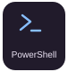
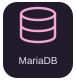
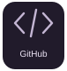

<picture>
  <source media="(prefers-color-scheme: light)" srcset="assets/hero-light.svg">
  
</picture>

**Practical projects. Small steps. Clear documentation.**

[About me](#about-me) · [Tech & tools](#tech--tools) · [Selected work](#selected-work)

 

<h2 align="center">About me</h2>

I'm Facundo. My public work brings together practical technical projects and the documentation behind them. I'm part of a collaborative Moodle upgrade project, where configuration templates, a PowerShell helper, and a documented Git workflow support the team's next steps. This profile is a small window into that work: the tools involved, the scope of the project, and the progress recorded in its repository.

<h2 align="center">Tech &amp; tools</h2>

  
  
  
  
  
  

Tools present in my public work · no proficiency ratings

How these tools are used

- **PowerShell:** helper for Moodle maintenance and upgrade commands.
- **PHP:** Moodle configuration template and CLI commands.
- **Moodle:** platform covered by the staged upgrade project.
- **MariaDB:** database selected in the configuration template.
- **Git & GitHub:** documented branching and team handoffs.

<h2 align="center">Selected work</h2>

<strong>Moodle Upgrade Workflow</strong> Collaborative project · In progress

A shared workspace for planning staged Moodle upgrades, documenting environment requirements, and coordinating handoffs. Includes a PHP configuration template, a PowerShell CLI helper, and an upgrade log.

  <a href="https://github.com/facundomanuelledesma/moodle_actualizacion">Explore the project ↗</a>
  &nbsp; · &nbsp;
  <a href="https://github.com/facundomanuelledesma/moodle_actualizacion/blob/main/BITACORA_ACTUALIZACION.md">Upgrade log</a>

Upgrade milestones and validation results are still to be recorded.

<h2 align="center">Let's connect</h2>

  

  

